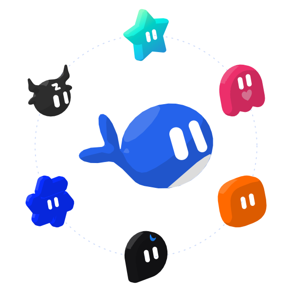
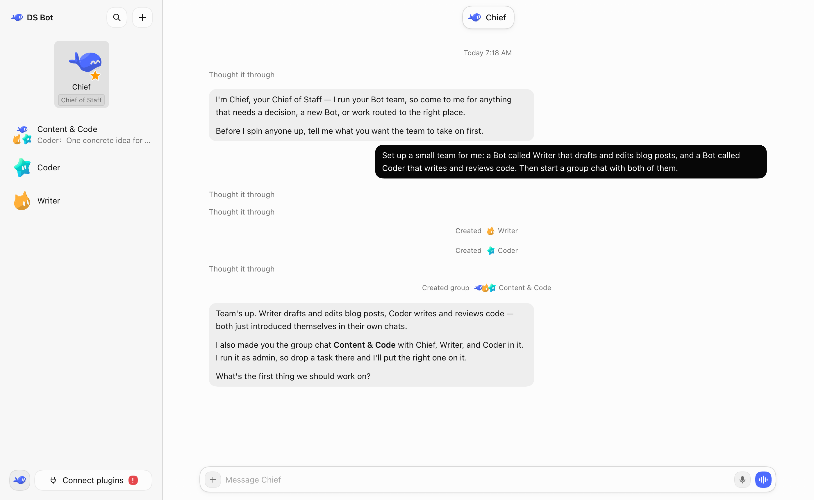
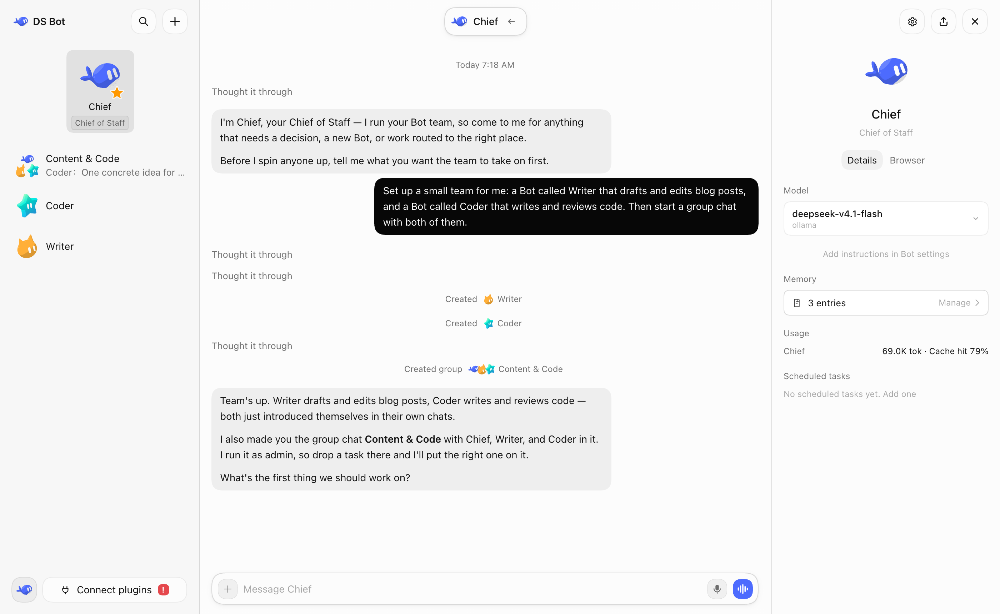
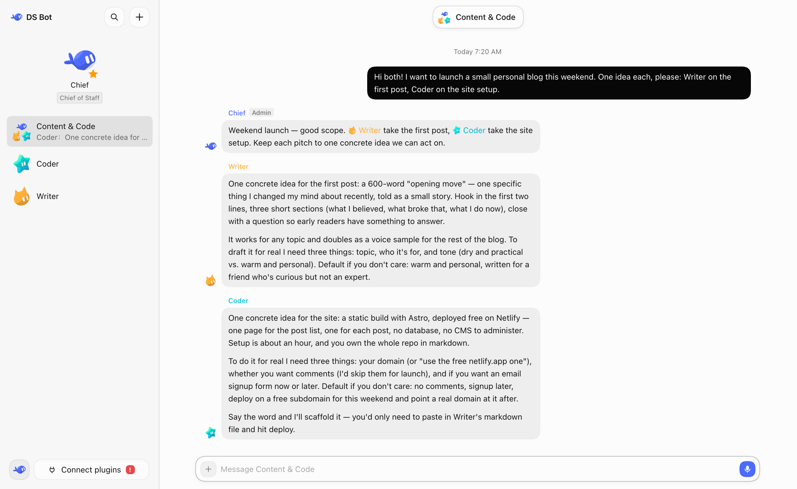
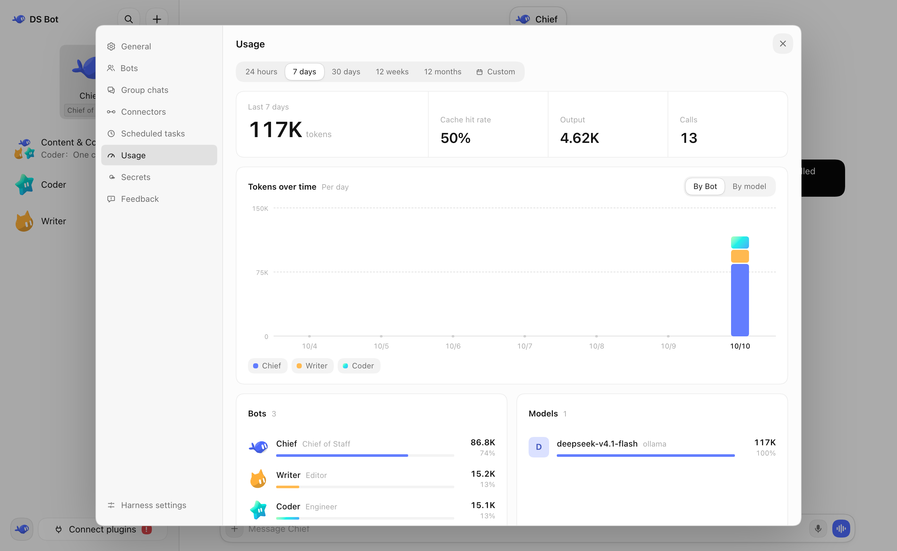

<p align="center">
  <picture>
    <source media="(prefers-color-scheme: dark)" srcset="docs/images/logo-dark.svg">
    
  </picture>
</p>

# 66AI Bot

English | [中文](README.zh.md)

  

66AI Bot is a standalone AI bot app: a team of long-lived bots with a main bot, bot-to-bot messages and group chats, in one desktop app (Windows, macOS, Linux). It runs on its own bundled AI engine runtime (DSH), keeps all data on your machine, and works with any OpenAI-compatible provider — including the 66AI engine. You create your own bots, then talk and work with them.



## Install

**Desktop app (Windows, macOS, Linux)**

The desktop app brings its own DSH, so you don't need to install DSH first. Download it from [Releases](https://github.com/66ai-bot/66ai-bot/releases):

- Windows (x64): `66ai-bot-<version>-win-x64.exe`. Run it; it installs for your user only, without administrator rights. If Windows shows "Windows protected your PC", select **More info** → **Run anyway**.
- macOS: `66ai-bot-<version>-mac-arm64.zip` for an Apple chip, `66ai-bot-<version>-mac-x64.zip` for Intel. Safari unzips it by itself; drag **66AI Bot** into **Applications** and open it. When macOS says it cannot check the app, open **System Settings** → **Privacy & Security** and select **Open Anyway**.
- Linux (x64): `66ai-bot-<version>-linux-x86_64.AppImage` runs on every distribution — make it executable and open it. It mounts through FUSE 2, which you may need to install first (`sudo apt install libfuse2t64` on Ubuntu 24.04+, `sudo dnf install fuse-libs` on Fedora, `sudo pacman -S fuse2` on Arch). On Ubuntu 24.04 and later an AppImage can refuse to start (Ubuntu restricts the sandbox it needs); the `66ai-bot-<version>-linux-amd64.deb` on Debian/Ubuntu does not have this problem and adds a menu entry.

At the first start the app asks where to keep its data and the Bots' files, and offers to copy a Bot team from your DSH (it only reads your DSH). Set up a model in its settings. The Windows app and the Linux AppImage update themselves; the macOS app and the Linux deb tell you when a new version is ready to download.

**Desktop app from source (Windows)**

With Node.js 22.19 or later and npm installed, run `.\start.ps1` in PowerShell from this checkout. It prepares and launches the current source, keeping your Bots, chats and model settings in `.66ai-bot-local/` between runs. See [source startup](app/README.md#run-from-source-windows).

**As a plugin in DSH**

First install DSH and set up at least one model in it. 66AI Bot uses the models from DSH.

**DSH Desktop (Windows, macOS)**

1. In the sidebar, select **Plugins** → **Add plugin**.
2. In **Package name or address**, enter `66ai-bot`. In mainland China, set **Registry** to **Mainland China mirror**.
3. Select **Install**, then **Enable now**. If DSH says the change takes effect at the next start, quit DSH completely and open it again.

If npm is not reachable, in step 2 you can also enter the full path of `66ai-bot-0.2.1.tgz` downloaded from [Releases](https://github.com/66ai-bot/66ai-bot/releases), or `github:66ai-bot/66ai-bot#v0.2.1&path:/66ai-bot` (needs Git).

66AI Bot 0.2.1 and earlier cannot update themselves in DSH Desktop 0.2.1-rc.2 or later: on the Plugins page, remove `66ai-bot` and add `66ai-bot` again. The Bots, chats and memory stay.

**DSH Web (Windows, macOS, Linux)**

Needs Node.js `22.19` or later, and pnpm.

```sh
npx @deepseek-ai/dsh@0.2.1-rc.4 plugin --profile web add 66ai-bot
npx @deepseek-ai/dsh@0.2.1-rc.4 web
```

**Docker (NAS, Linux server)**

The [`docker/`](docker/) directory builds an image with DSH Web and 66AI Bot, for a NAS or any always-on machine. CI is configured to publish a prebuilt linux/amd64 image to GHCR. The container is the Bots' sandbox: they get full access to what you mount into it, and nothing else. See [`docker/README.md`](docker/README.md).

## Setup

I strongly recommend that you set up your other bots and group chats by just talking to a bot.

### Models: use the 66AI engine

66AI Bot works with any OpenAI-compatible provider. Configure providers in **Settings** (the embedded AI engine keeps providers in the profile's `cordis.patch.yml` and keys in `.credentials.yaml` in the data location). The 66AI engine speaks the OpenAI Chat Completions protocol:

| Engine | Base URL | Model |
|---|---|---|
| 66AI engine (public) | `https://gptapi.66ai.biz/v1` | `chatgpt-6-luna` |
| 66AI engine (this machine) | `http://127.0.0.1:6010/v1` | `chatgpt-6-luna` |

Add a provider with that Base URL, paste your 66AI API key, pick `chatgpt-6-luna` as the model, and every Bot in the team runs on it. As a shortcut on one machine, you can also launch with the default provider pointed at the engine:

```sh
DEEPSEEK_BASE_URL=http://127.0.0.1:6010/v1 DEEPSEEK_API_KEY=<your 66AI key> npm start
```

### Account: sign in with your 66AI account

The app starts at a sign-in gate. **Create an account** (or sign in) and the same account works on the web and in the admin console at `cm.66ai.biz` — new accounts land in the unified user list with the standard trial points, and the point balances follow the cloud (admin top-ups arrive at the next sync; the account card in the sidebar shows the balances and signs out). The account service can be overridden for self-hosted deployments:

| Variable | Default | Meaning |
|---|---|---|
| `CM_BASE_URL` | `https://cm.66ai.biz` | the account service base |
| `CM_SECRET` | (built in) | the client secret shared with the service |

### Web search

66AI Bot selects its `auto` search provider for the whole profile. If you disable `web-search-auto`, also select another registered search provider in that profile. See [Web search](66ai-bot/README.md#web-search) and the [recovery steps](docs/known-issues.md#web-search-fails-everywhere-after-turning-off-web-search-auto).

## Features

### Bot

You can do all your talking and work with one bot, in one window. You don't need to worry about the context behind it. The bot's details page shows its info, and there you can pick the model you want it to use. You can switch models at any time, but I still recommend that you keep one model for a bot for a long time, and switch only when you really need to.

Bots also have memory. A bot remembers what you like and uses it in later work. You can manage its memory on the bot's details page, or just tell the bot.



### Main bot

The main bot is your chief. It has very high rights: it manages the other bots and the group chats. The first time you open 66AI Bot, there is already a main bot called Chief. Talk to it, and it walks you through the setup.

In short: have a question? Ask the main bot.

### Group chats

66AI Bot has group chats. A group chat is a great way to get several bots to work together, but it clearly costs more. So 66AI Bot does this: every group chat has an admin. The admin answers your messages by default and calls in the other bots for you. You can also @ a bot directly, and it answers you directly: type @ and pick the bot from the list. To give the bots another chat as context, use + → Reference a chat in the message box.

Any bot can hand work to another bot with @. That bot does the work on its own, and the group goes on. While it works, it keeps the group posted, and the group, the sidebar and its own chat show what it is doing. When it is done, it posts the result in the group, and the bot that asked for the work answers. To stop the work, open the group's details.

A group chat has its own memory. What you tell the group stays in the group: its members use it there, and your other chats and the bots outside the group do not see it. You can manage it in the group's details.



### Capabilities

Settings → **Capabilities** is a shared library of MCP servers, skills and packs. Add a capability to a Bot in its settings; it is available from that Bot's next message in its own chat and group chats. A local MCP command that a Bot adds needs your approval before it can run. While other Bots use a capability, only you or a Main Bot can change or delete it.

### Usage

In **Settings** → **Usage**, you can see token usage by time, by bot and by model.



### Office files

Bots work with Office documents. They can create and edit .docx, .pptx and .xlsx, read a document's structure with stable ids, check a package for the defects Office would refuse, make targeted edits (comments, tracked changes, fields, table cells), reorder or duplicate slides, list workbook errors, and review rendered pages on a contact sheet. The desktop app includes everything needed; in DSH Desktop Bots use DSH's Office runtime plus 66AI Bot's commands; in DSH Web the inspect, check and edit commands work, while creating files from scratch and rendering pages need the desktop app or DSH Desktop.

## Data

All data stays on your own computer, in `bot/` and `sessions/` in the DSH home folder (`~/.dsh` by default). Uninstalling the plugin does not delete this data.

## Development

The plugin source is in [`66ai-bot/`](66ai-bot/). For options and internals, see [`66ai-bot/README.md`](66ai-bot/README.md). For development, tests and how the team works, see [CONTRIBUTING.md](CONTRIBUTING.md). For changes between versions, see [CHANGELOG.md](CHANGELOG.md).

## Acknowledgments

- [DeepSeek Harness](https://github.com/deepseek-ai/deepseek-harness): 66AI Bot is built on the DSH plugin system. Every bot works in DSH sessions and uses the DSH tools and models.
- [esbuild](https://esbuild.github.io/): bundles the plugin's interface code.
- Thanks to these projects for the ideas they published. 66AI Bot learned from their designs and does not contain their code:
  - [AgentMemoryRepo](https://github.com/AgentMemoryRepo/agentmemoryrepo): the Markdown format of Bot memory.
  - [OpenAI Codex](https://github.com/openai/codex): checkpoints that keep the user's messages next to the summary, and message anchors for chat search.
  - [OpenMausBot](https://github.com/milind-soni/OpenMausBot): group chat rounds and @mention relays.
  - [Hermes Agent](https://github.com/NousResearch/hermes-agent) and [Hermes Bot Mode](https://github.com/NousResearch/Hermes-Bot-Mode): one session per member per group chat, and handoffs that carry the earlier user messages.
  - [OpenCode](https://github.com/sst/opencode), [goose](https://github.com/block/goose), [pi](https://github.com/badlogic/pi-mono) and [Gemini CLI](https://github.com/google-gemini/gemini-cli): when to condense a long chat, and what a handoff note holds.
  - [obelisk](https://github.com/tommy0103/obelisk): chat search with a SQLite full-text index.
- Everyone who tries 66AI Bot, asks questions and reports bugs.

## License

[Apache License 2.0](LICENSE). Provided "as is", without any warranty. Third-party code and its license are listed in [NOTICE](NOTICE).

## Disclaimer

66AI Bot is an independent community project. **It is not an official DeepSeek product**, and it is not affiliated with, endorsed by or sponsored by DeepSeek. "DeepSeek", "DeepSeek Harness" and the other names are trademarks of their owners. They are used here only to say what this plugin works with.

Bots use your own model quota, and they read and write files and run commands when you ask them to. Check important actions yourself.
